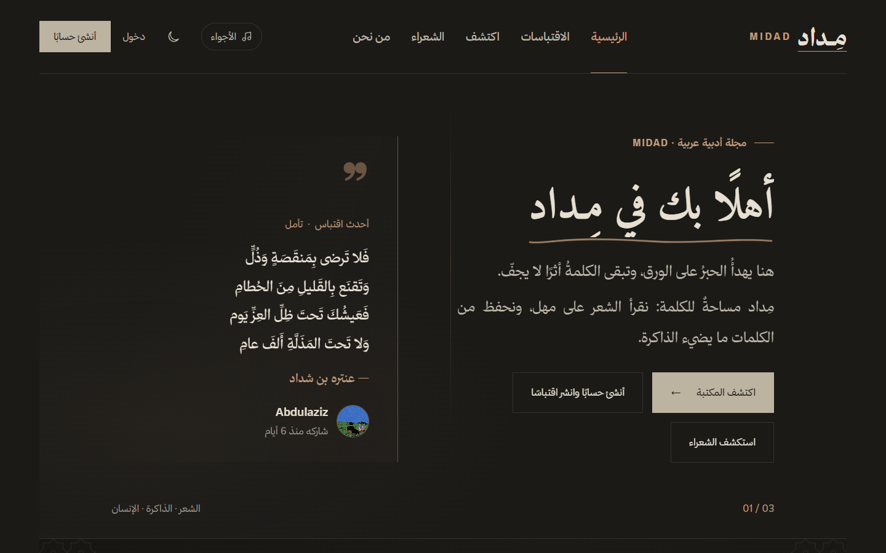
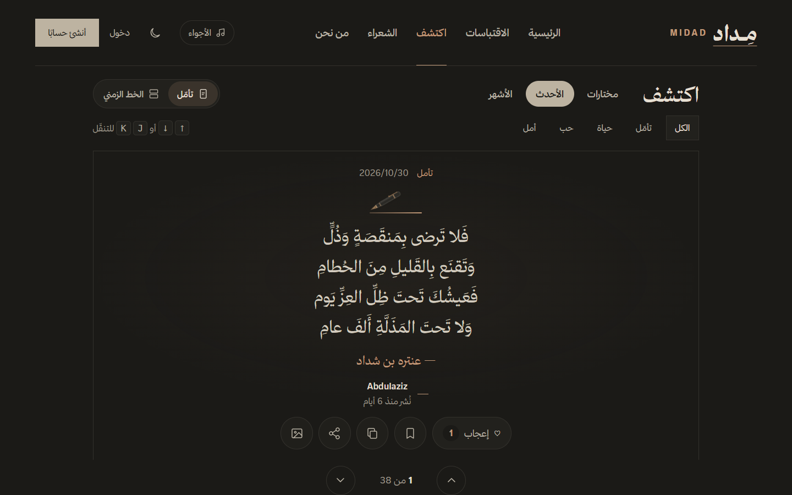
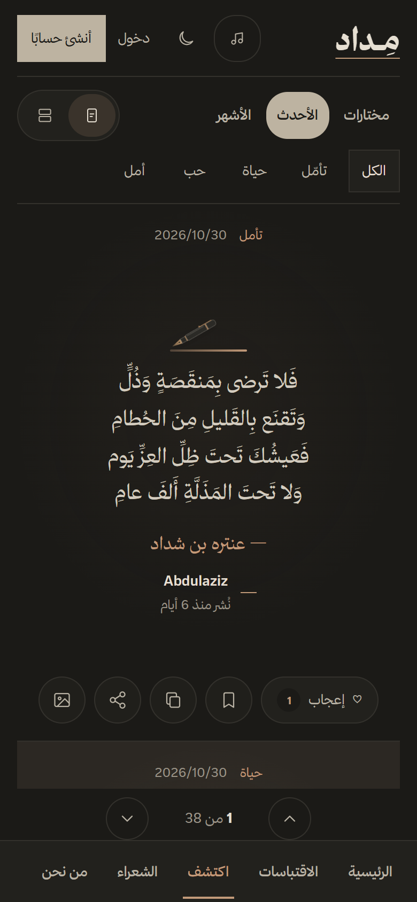
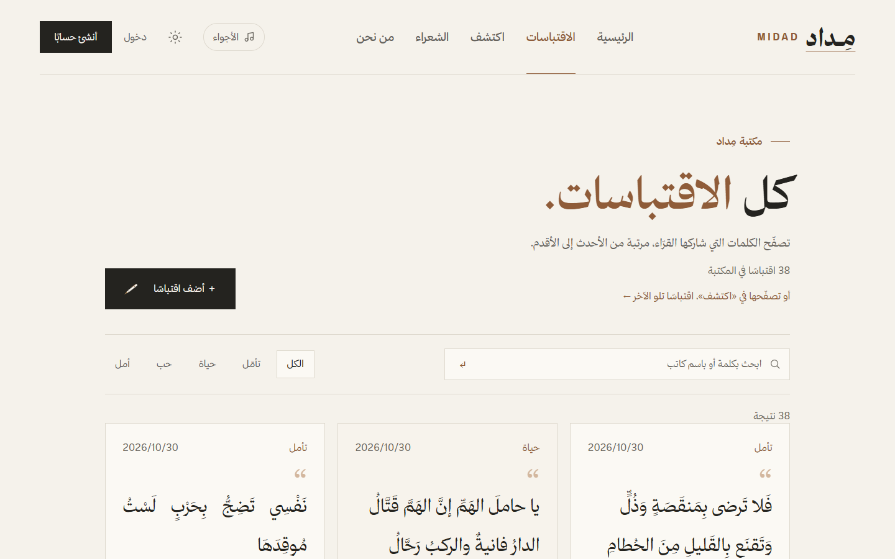
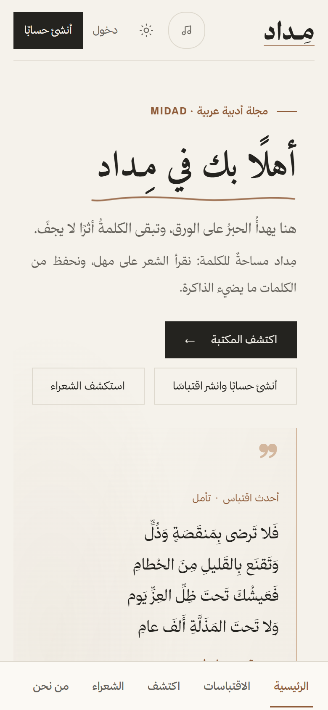

<div align="center">


**A calm space where readers share the words that stayed with them.**

<a href="https://midad-zcbt.onrender.com"></a>


<br /><br />

<a href="https://midad-zcbt.onrender.com"></a>

[English](#english) · [العربية](#arabic)

</div>

<a id="english"></a>

## About

MIDAD (مِداد, "ink") is a calm Arabic space for quotes and poetry. Anyone can read and search the library; members share the quotes that stayed with them, save what they love, comment, and follow readers with similar taste. The whole interface is Arabic and right-to-left, with light and dark themes, and works on phones and desktops.

It is my individual final project for the Al-Qimma bootcamp at Tuwaiq Club (programming and development track), built end to end, from the database to the interface and deployment.

## Features

- **Library:** browse, search by text, author or source, and filter by category
- **Discover:** one quote per screen, or a timeline of cards, ranked for each reader by freshness, appreciation and their favourite categories and authors ([how it ranks](docs/FEED_ALGORITHM.md))
- **Community:** likes, saves, comments, follows and notifications
- **Profiles:** bio, links, profile picture and cover (animated GIFs welcome)
- **Literary pages:** the seven Mu'allaqat and a guide to the poets
- **Sharing:** copy a quote, share its link, or share it as a generated image
- **Admin panel:** site numbers, search and moderate every quote, and a safe password-recovery flow that works even when email cannot be sent

## Screenshots

<table>
<tr>
<td width="77%"></td>
<td width="23%"></td>
</tr>
<tr>
<td width="77%"></td>
<td width="23%"></td>
</tr>
</table>

## Built with care

- **Security:** hashed passwords, CSRF protection, a strict Content-Security-Policy, HTTPS-only cookies, rate limits on sign-in and on members' actions, and real-content checks on every upload
- **Performance:** a fixed number of queries per page, indexes for every list, and a load test with 50 visitors at once where 95% of requests finished in under 150 ms with zero errors ([load test](load-test/README.md))
- **Tests:** 140+ automated feature tests with Pest
- **Accessibility:** keyboard navigation, visible focus and respect for reduced motion

## Tech stack

Laravel 12 · PHP 8.3 · Blade · Vite · PostgreSQL (SQLite for local development) · Docker · Render

## Run it locally

You need PHP 8.2+ with the SQLite extension, Composer, and Node.js 18+.

```sh
composer install
cp .env.example .env            # PowerShell: copy .env.example .env
php artisan key:generate
php -r "file_exists('database/database.sqlite') || touch('database/database.sqlite');"
php artisan migrate --seed
npm install && npm run build
php artisan serve
```

Open `http://127.0.0.1:8000` and create an account. The database starts empty.

Run the tests (they use an in-memory database and never touch yours):

```sh
php artisan test
```

## Documentation

| File | What it covers |
|:--|:--|
| [docs/SRS.md](docs/SRS.md) | Software requirements specification |
| [docs/ERD.mmd](docs/ERD.mmd) | Database diagram (Mermaid) |
| [docs/FEED_ALGORITHM.md](docs/FEED_ALGORITHM.md) | How Discover orders quotes |
| [DEPLOY.md](DEPLOY.md) | Deploying with Docker on Render |
| [load-test/README.md](load-test/README.md) | Running the k6 load test |

## Author

**Abdulaziz Al-Matrafi**, Software Engineering student at Umm Al-Qura University.
[LinkedIn](https://www.linkedin.com/in/abdulaziz-al-matrafi-bbb238358/) · [GitHub](https://github.com/I4zln)

---

<a id="arabic"></a>

<div dir="rtl">

## عن مِداد

مِداد مساحة عربية هادئة للاقتباسات والشعر. يقرأ فيها الجميع ويبحثون في المكتبة، ويشارك الأعضاء الاقتباسات التي تركت فيهم أثرًا، ويحفظون ما يعجبهم، ويعلّقون، ويتابعون من يشبههم ذوقًا. الواجهة عربية بالكامل من اليمين إلى اليسار، بوضعين فاتح وداكن، وتعمل على الجوال والحاسب.

وهو مشروعي النهائي الفردي في معسكر القمّة بنادي طويق (مسار البرمجة والتطوير)، بنيته كاملًا من قاعدة البيانات إلى الواجهة والنشر.

**جرّبه الآن:** [midad-zcbt.onrender.com](https://midad-zcbt.onrender.com)

## المزايا

- **المكتبة:** تصفّح الاقتباسات وابحث بالنص أو الكاتب أو المصدر، وصنّفها
- **«اكتشف»:** اقتباس واحد في كل شاشة أو قائمة متصلة، مرتّبة لكل قارئ حسب حداثتها وتفاعل القرّاء معها وتصنيفاته وكتّابه المفضّلين
- **المجتمع:** الإعجاب والحفظ والتعليق والمتابعة والإشعارات
- **الملف الشخصي:** نبذة وروابط وصورة شخصية وغلاف، ويمكن أن تكون GIF متحركة
- **صفحات أدبية:** المعلّقات السبع ودليل للشعراء
- **المشاركة:** نسخ الاقتباس أو مشاركة رابطه أو مشاركته صورةً
- **لوحة الإدارة:** أرقام الموقع، والبحث في كل الاقتباسات وحذف ما لا يناسب، واستعادة آمنة لكلمة المرور حتى حين يتعذّر إرسال البريد

## الجودة

- **الحماية:** كلمات مرور مشفّرة، وحماية من CSRF، وسياسة أمان صارمة للمحتوى، وحدود للطلبات، وفحص حقيقي لكل صورة تُرفع
- **الأداء:** عدد ثابت من الاستعلامات لكل صفحة، وفهارس لكل قائمة، واختبار ضغط بخمسين زائرًا في الوقت نفسه: 95% من الطلبات أقل من 150 جزءًا من الثانية دون أي خطأ
- **الاختبارات:** أكثر من 140 اختبارًا آليًا

## التشغيل محليًا

تحتاج PHP 8.2 أو أحدث مع امتداد SQLite، وComposer، وNode.js 18 أو أحدث، ثم شغّل الأوامر المذكورة في قسم [Run it locally](#run-it-locally) بالترتيب، وافتح `http://127.0.0.1:8000` وأنشئ حسابًا.

## صاحب المشروع

**عبدالعزيز المطرفي**، طالب هندسة البرمجيات في جامعة أم القرى.

</div>

<div align="center">


</div>
